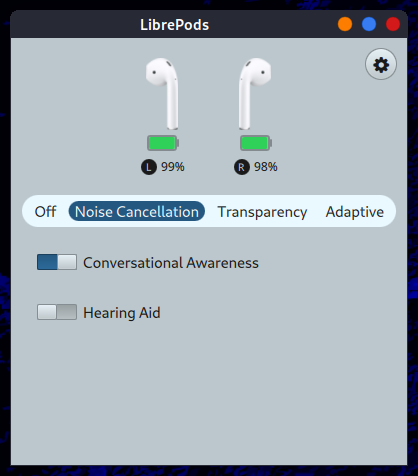
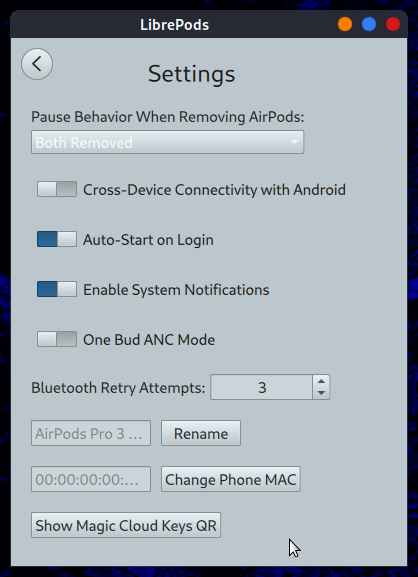

# librepods-syslinuxos

Prebuilt `.deb` package of [LibrePods](https://github.com/librepods-org/librepods) for **SysLinuxOS 13 / Debian 13 (trixie)** — amd64.

LibrePods brings AirPods features to Linux: noise control (ANC/Transparency/Off/Adaptive), battery monitoring, ear detection (auto play/pause), conversational awareness, and more.

| Main | Settings |
|------|----------|
|  |  |

## Install

### Via SysLinuxOS APT repo (recommended)

```bash
# Add the SysLinuxOS-Tools repo (one-time setup)
curl -fsSL https://fconidi.github.io/SysLinuxOS-Tools/KEY.gpg | sudo gpg --dearmor -o /etc/apt/keyrings/syslinuxos-tools.gpg
echo "deb [signed-by=/etc/apt/keyrings/syslinuxos-tools.gpg] https://fconidi.github.io/SysLinuxOS-Tools tirreno main" | sudo tee /etc/apt/sources.list.d/syslinuxos-tools.list
sudo apt update && sudo apt install librepods
```

### Direct .deb download

Download from [Releases](https://github.com/fconidi/librepods-syslinuxos/releases) and install:

```bash
sudo apt install ./librepods_0.1.0_amd64.deb
```

## AirPods Pro 3 pairing on Linux

1. Place both earbuds in the case and close the lid
2. Open the lid
3. **Double-tap the center of the case** — the LED flashes white (pairing mode)
4. Pair via `bluetoothctl`: `scan on` → `pair <MAC>` → `trust <MAC>` → `connect <MAC>`

## Post-install setup (auto via postinst)

The package automatically configures BlueZ with the Apple DeviceID in `/etc/bluetooth/main.conf`.

For AVRCP (auto play/pause on ear removal), copy the included WirePlumber config:

```bash
mkdir -p ~/.config/wireplumber/wireplumber.conf.d
cp /usr/share/doc/librepods/51-bluez-avrcp.conf ~/.config/wireplumber/wireplumber.conf.d/
systemctl --user restart wireplumber
```

## Build from source

Built from [librepods-org/librepods](https://github.com/librepods-org/librepods) `main` branch on SysLinuxOS 13 (Debian 13, Qt 6.8.2, BlueZ 5.82).

```bash
sudo apt install cmake pkg-config libssl-dev libpulse-dev qt6-base-dev qt6-connectivity-dev qt6-declarative-dev qt6-multimedia-dev qttools6-dev-tools
git clone --depth=1 https://github.com/librepods-org/librepods.git
mkdir -p librepods/linux/build && cd librepods/linux/build
cmake .. && make -j$(nproc)
```

## License

**Full feature list:**
- Noise modes: Off / Noise Cancellation / Transparency / Adaptive
- Battery % per earbud (L/R) and case
- Ear detection — auto pause when removed (configurable: one or both)
- Conversational Awareness toggle
- One Bud ANC Mode
- Cross-Device Connectivity with Android
- Auto-Start on Login
- System Notifications
- Rename device
- Change Phone MAC
- Magic Cloud Keys QR
- CLI control via `librepods-ctl`

## License

LibrePods upstream: [GPL-3.0](https://github.com/librepods-org/librepods/blob/main/LICENSE)  
Packaging: Franco Conidi — [syslinuxos.com](https://syslinuxos.com)
